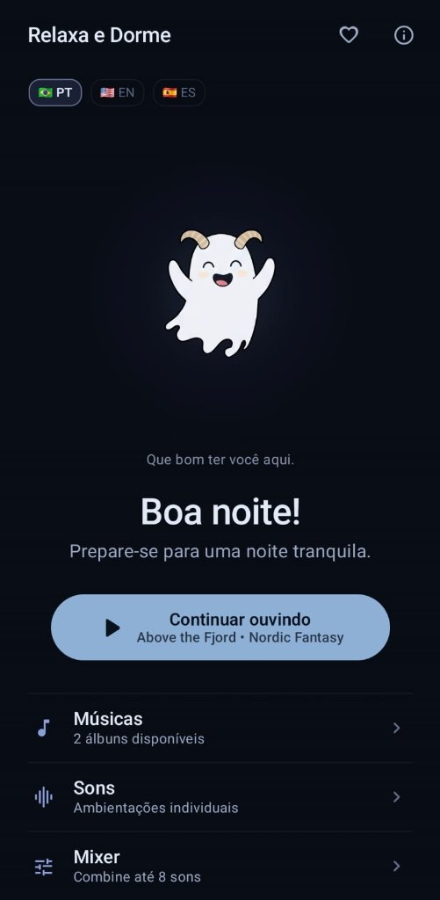
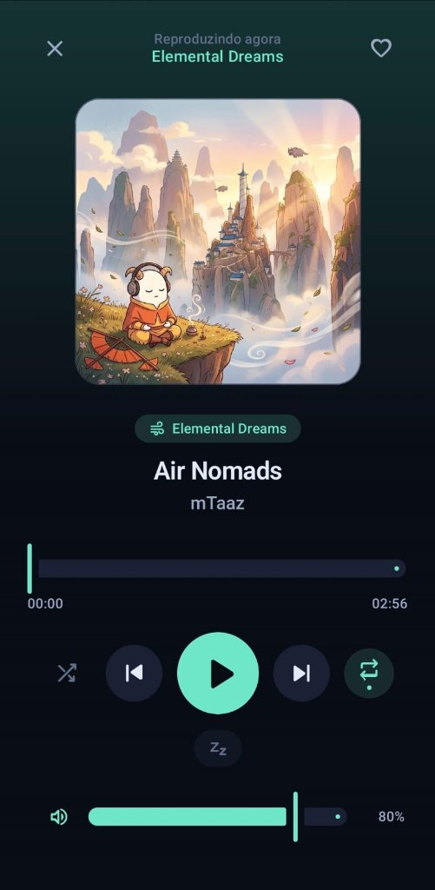
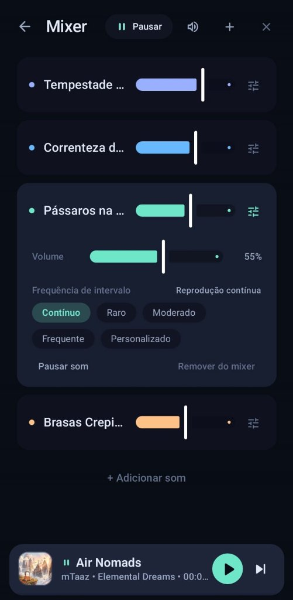
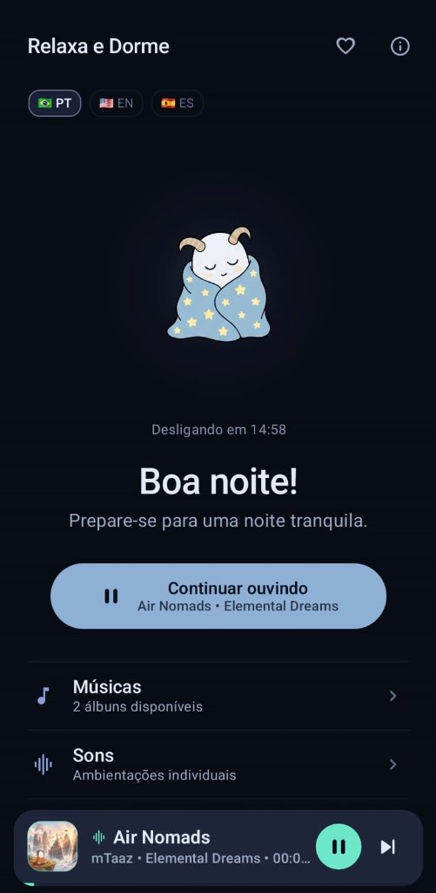

 

# Relaxa e Dorme

### *Seu refúgio de tranquilidade.*

Um espaço sereno para desacelerar a mente, ouvir músicas relaxantes e combinar sons da natureza antes de dormir — sem anúncios, sem distrações e no seu próprio ritmo.

 

 

Disponível gratuitamente em APK assinado nas <a href="https://github.com/MatheusTaaz/Relaxa-Dorme/releases/latest">Releases oficiais do GitHub</a>.

 
 

---

## Capturas de Tela

<table>
  <tr>
    <td align="center" width="25%">
       
      <b>Home</b> Saudação noturna e acesso rápido
    </td>
    <td align="center" width="25%">
       
      <b>Player Musical</b> Álbuns autorais e modo offline
    </td>
    <td align="center" width="25%">
       
      <b>Mixer de Sons</b> Camadas sonoras independentes
    </td>
    <td align="center" width="25%">
       
      <b>Ghosty Buddy</b> Companheira interativa de descanso
    </td>
  </tr>
</table>

---

## Experiência e Funcionalidades

Projetado com uma paleta noturna de baixa emissão de luz (`#090C15`), o **Relaxa e Dorme** reúne música ambiente e paisagens sonoras personalizáveis em uma interface calma e silenciosa.

<table>
  <tr>
    <td width="50%" valign="top">
      <h4>🎵 Música Relaxante &amp; Segundo Plano</h4>
      
Ouça álbuns instrumentais e faixas suaves por streaming ou baixe seus álbuns preferidos para reprodução totalmente offline, com suporte contínuo em segundo plano e controles na tela de bloqueio.

    </td>
    <td width="50%" valign="top">
      <h4>🌧️ Sons Ambientes &amp; Mixer de Áudio</h4>
      
Combine chuva, correnteza de rio, vento na floresta, lareira e ruídos suaves. Misture múltiplos sons ambientes simultaneamente — sozinhos ou acompanhando uma música — com volume individual por camada.

    </td>
  </tr>
  <tr>
    <td width="50%" valign="top">
      <h4>🌙 Temporizador com Fade-out &amp; Ghosty Buddy</h4>
      
Programe o desligamento automático com redução gradual de volume (<i>fade-out</i>) para não interromper o sono brusca­mente, acompanhado pelas reações visuais tranquilas da mascote <b>Ghosty Buddy</b>.

    </td>
    <td width="50%" valign="top">
      <h4>🤍 Favoritos &amp; Estatísticas Locais</h4>
      
Salve suas faixas favoritas, crie cenas sonoras personalizadas e acompanhe seu tempo de tranquilidade com estatísticas de audição armazenadas exclusivamente no seu dispositivo.

    </td>
  </tr>
</table>

---

## Tecnologias

Construído de forma nativa para Android com foco em leveza, privacidade e reprodução de áudio confiável:

| Tecnologia | Papel no Aplicativo |
| :--- | :--- |
| **Kotlin** | Linguagem principal e arquitetura reativa com Coroutines & Flow |
| **Jetpack Compose** | Interface declarativa moderna, fluida e adaptada ao tema escuro |
| **Material 3** | Sistema visual customizado com contrastes suaves para leitura noturna |
| **AndroidX Media3** | Motor `ExoPlayer` e `MediaSessionService` para mixagem e segundo plano |
| **Gradle** | Automação de build, verificação estática e empacotamento reprodutível |

---

## Licenciamento e Créditos

O código-fonte deste repositório público é distribuído sob a licença **GNU General Public License v3.0 apenas (`GPL-3.0-only`)**.  
Determinados recursos visuais, ilustrações e arquivos de áudio possuem origens e condições de licenciamento próprias — não sendo todos os assets de domínio público nem de propriedade exclusiva do autor.

[**LICENSE**](LICENSE) &nbsp;•&nbsp; [**NOTICE**](NOTICE) &nbsp;•&nbsp; [**AUDIO_LICENSES.md**](AUDIO_LICENSES.md) &nbsp;•&nbsp; [**LICENSE-ASSETS.md**](LICENSE-ASSETS.md) &nbsp;•&nbsp; [**CONTRIBUTING.md**](CONTRIBUTING.md)

 

Criado por <b>mTaaz</b> &nbsp;•&nbsp; Idiomas no app: Português (BR), English e Español.

